# EuroSAT land-use classification: reproducing Helber et al. on the RGB images

**Project 4 - satellite image classification.** Paper reproduced: P. Helber, B. Bischke,
A. Dengel, D. Borth, *EuroSAT: A Novel Dataset and Deep Learning Benchmark for Land Use and Land
Cover Classification*, arXiv:1709.00029v2 (IEEE JSTARS 2019).

All numbers and figures below are produced by the code in this repository
(`scripts/00_...` to `scripts/04_...`); tables are inserted from `results/tables/` when the
report is built, so nothing is copied by hand. How to rerun everything: [README.md](README.md).

---

## 1. Summary

* **Data.** EuroSAT RGB: 27,000 Sentinel-2 patches of 64 x 64 pixels (10 m per pixel), ten
  classes of 2,000 to 3,000 images, no duplicates. Exploration predicts three groups of
  look-alike classes: the four vegetation / agricultural classes, Highway / River, and
  Industrial / Residential.
* **Protocol.** The paper's class-wise train/test splits (10/90 ... 90/10), plus a validation
  set carved out of each training portion, so that every model choice is made without the test
  set.
* **Table III (main result) is reproduced.** ImageNet-pretrained, fine-tuned ResNet-50: 98.76%
  (paper 98.57%); GoogLeNet: 98.24% (paper 98.18%). Both paper values lie inside our 95%
  confidence intervals, ResNet-50 is again the better network, and three seeds give
  98.86 ± 0.16% and 98.41 ± 0.17%.
* **Table II.** The bag-of-visual-words baseline (SIFT + SVM) is reproduced within 3.5 points
  in all 27 cells - but only after tuning the SIFT detector on validation data: with OpenCV's
  default detector 28% of the patches contain no keypoint and the validation accuracy drops from
  73% to 52%. The
  CNN rows reproduce the paper's ordering (BoVW << shallow CNN < deep CNNs) but our networks are
  more accurate than the paper's, by 7-11 points for the two-layer CNN and by up to 15 points
  for the deep networks on the smallest training set. The paper does not describe how these
  were trained; Section 6.1 discusses the likely reasons.
* **Comparing the paper's approaches.** On the same 80/20 test set: SIFT bag of words 55-72%,
  two-layer CNN 94.7%, deep networks from scratch 98.0-98.1%, fine-tuned 98.2-98.8%. Learned
  features are the largest step (+23 points over the best BoVW); frozen ImageNet features with
  a new last layer only reach 94.3% - they must be fine-tuned.
* **Errors.** The best model makes 67 errors on 5,400 images. Half of them are confusions
  between the agricultural / vegetation classes, 15% between Highway and River; many are
  patches that contain two land covers or are visually ambiguous at 10 m resolution.

---

## 2. Scope: what is reproduced and what is not

| Paper | Reproduced here |
|---|---|
| **Table II** - BoVW (SIFT + SVM, k = 10 / 100 / 500), a two-layer CNN, ResNet-50 and GoogLeNet trained from random initialisation, on nine train/test splits (10/90 ... 90/10) | yes, all 6 x 9 cells |
| **Table III**, EuroSAT column - ImageNet-pretrained ResNet-50 and GoogLeNet, fine-tuned, 80/20 split | yes |
| **Fig. 8** - confusion matrix of the fine-tuned ResNet-50 | yes |
| Table III, columns UCM / AID / SAT-6 / BCS | no - other datasets |
| Table IV, Fig. 9 - single spectral bands and band combinations | no - needs the 13-band version; the project brief asks for the RGB version only |
| Sec. V - change detection and map assistance | no - needs raw Sentinel-2 scenes |

Beyond the paper, the project brief asks for data exploration, a documented pipeline with a
train / validation / test separation, a comparison of approaches and an error analysis.
These are Sections 3, 4, 6.3 and 7; they use only the paper's own experiments.

---

## 3. Exploring the data

Descriptive statistics use all 27,000 images. Everything that could influence modelling
decisions (class profiles, nearest-neighbour analysis, embedding) uses **only the training
images of the 80/20 split**, so that the test set stays unseen until the final evaluation.

### 3.1 What is in the archive

`EuroSAT_RGB.zip` (94.7 MB, MD5 verified against the Zenodo record) contains 27,000 JPEG files
in ten class folders. Every image decodes to 64 x 64 pixels with three 8-bit channels
(checked for all files); the files are small (982 to 5,229 bytes, median 3,457 bytes), i.e. the
images are fairly strongly JPEG-compressed. The pixel values use the full range 0-255. One
pixel covers 10 m x 10 m, so a patch shows 640 m x 640 m of ground.

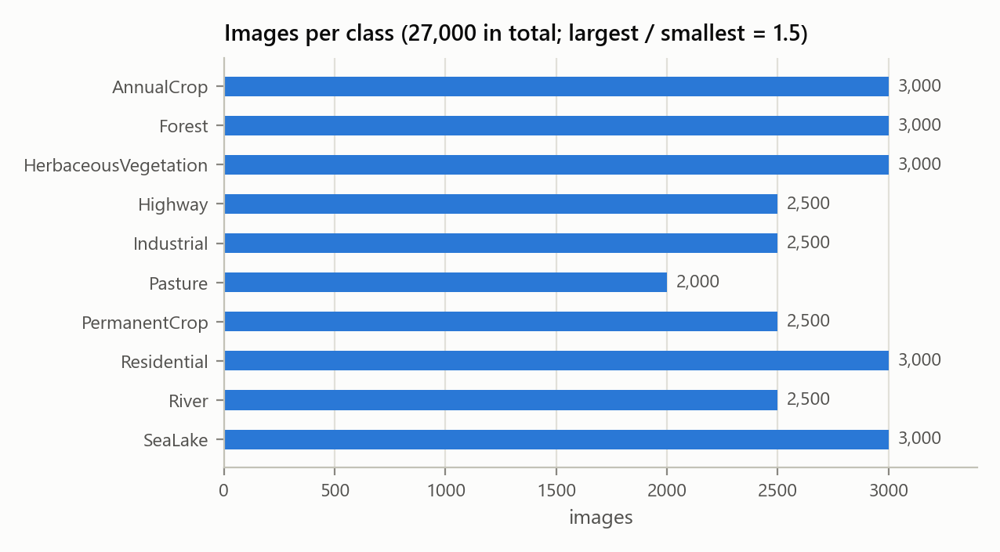

The class frequencies agree with the paper (2,000 to 3,000 images per class). The imbalance is
mild (largest / smallest = 1.5), so overall accuracy - the paper's metric - is a reasonable
summary; we report macro-F1 and per-class recall alongside it. A classifier that always answers
with the largest class would reach 11.1%.

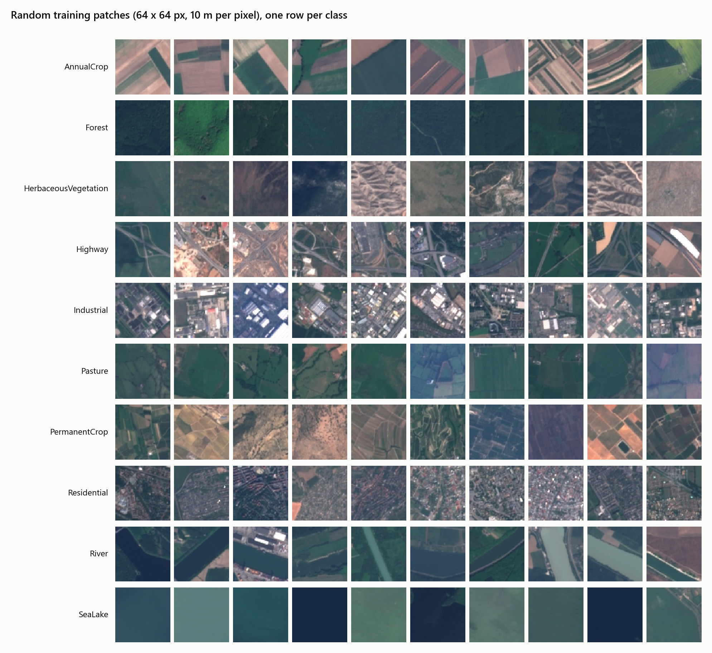

Reading the rows of the sample grid already suggests where the difficulties lie:

* **Forest** and **Sea & Lake** are homogeneous dark patches that differ mostly in hue and fine texture.
* **Annual crop**, **Permanent crop**, **Pasture** and **Herbaceous vegetation** are all
  "fields and vegetation"; what separates them is the geometry of the parcels and the season.
* **Highway** and **River** are both a thin linear structure crossing some *other* land cover;
  most of the pixels in such a patch belong to the background class.
* **Industrial** and **Residential** are both built-up; industrial buildings are larger and brighter.

### 3.2 Image properties per class

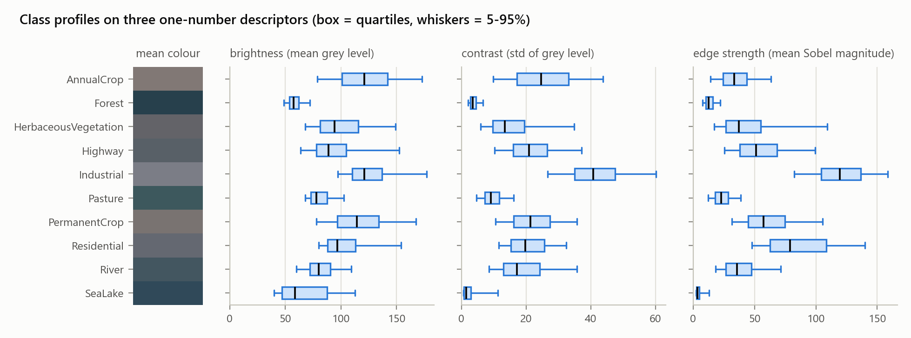

Three one-number descriptors (brightness, contrast, edge strength) already separate some
classes: Sea & Lake (median contrast 1.4 grey levels, median edge strength 3.5) and Forest (3.5
and 12.8) are almost flat, Industrial has by far the strongest edges (119.6) followed by
Residential (79.0). But the four vegetation / agriculture classes and Highway / River overlap on
all three, so they cannot be separated by global statistics. The mean colours are also close to
each other: all classes are a dark blue-green-grey, because the images are not atmospherically
corrected (training-set channel means R 0.345, G 0.381, B 0.408 on a 0-1 scale - blue is the
brightest channel).

### 3.3 Which classes are hard to tell apart?

Before training anything we asked a model-free question: *if every training image is described
only by its colour histogram, which class does its nearest neighbour belong to?*

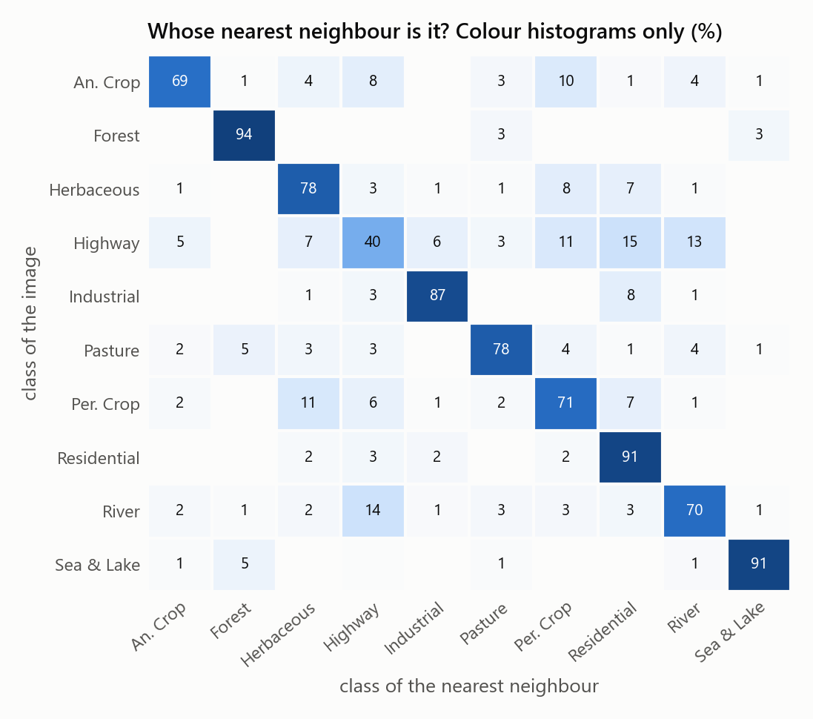

Colour alone finds a same-class neighbour for 77.5% of the training images. The off-diagonal
mass tells us which categories to watch:

| Pair | mutual confusion (mean of both directions) |
|---|---:|
| Highway - River | 13.6% |
| Herbaceous vegetation - Permanent crop | 9.6% |
| Highway - Residential | 8.7% |
| Highway - Permanent crop | 8.4% |
| Annual crop - Highway | 6.1% |
| Annual crop - Permanent crop | 6.0% |
| Industrial - Residential | 5.1% |

**Highway is the hardest class** for a colour description (only 40% of the highway images have
a highway image as nearest neighbour): its colour is the colour of whatever surrounds the road.
The same picture appears in a 2-D embedding of the colour histograms, where Forest, Sea & Lake,
Industrial and Pasture form compact groups while Highway, River and the crop classes are
spread over the whole map:

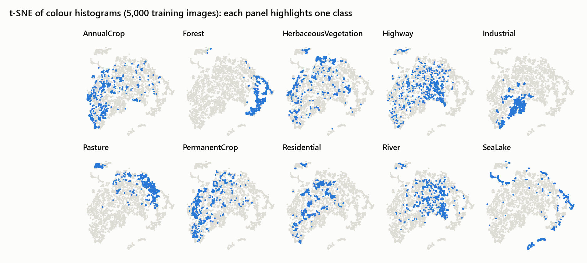

Expectation for the experiments: separating Highway / River and the agricultural classes
needs *spatial structure* (thin lines, parcel geometry), i.e. texture features or learned
filters, rather than global colour statistics.

### 3.4 Data quality

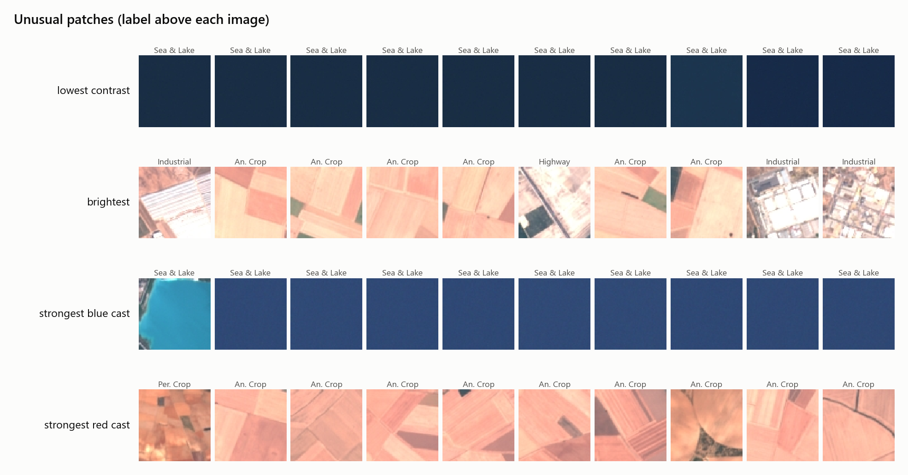

* **No exact duplicates** among the 27,000 images (hash of the decoded pixels).
* **Near-constant images.** 1,936 of the 3,000 Sea & Lake patches and 128 Forest patches have a
  grey-level standard deviation below 2: they are essentially a single colour. This matters for
  any method that relies on local structure (Section 5.1).
* **Colour casts and brightness.** Mean brightness ranges from 36 to 216 grey levels; the
  brightest patches are bare fields with a red-orange cast, and some water patches are a
  saturated blue. The paper keeps such images on purpose ("we did not filter the respective
  samples"), and so do we.
* **Train / test proximity.** Patches cut from the same satellite scene could be near-copies of
  each other. For every test image of the 80/20 split we searched the most similar train /
  validation image and measured the pixel RMSE. 770 of 5,400 test images have a counterpart
  within 4 grey levels, but all of them are Forest (303) or Sea & Lake (467) patches, which are
  nearly uniform anyway; no patch of the eight other classes has such a twin
  (`figures/eda_closest_train_test.png`). The random split therefore does not leak
  pixel-identical content, although patches from the same scene still share season, haze and
  region - see Limitations.

---

## 4. Pipeline and evaluation protocol

### 4.1 Loading

`scripts/00_prepare_data.py` downloads the archive from the Zenodo record published by the
paper's authors (DOI 10.5281/zenodo.7711810), verifies size and MD5, extracts the JPEGs and
decodes them once with Pillow into a single array `X` of shape (27000, 64, 64, 3), `uint8`,
RGB. The order is fixed (class folders alphabetically = label 0...9, then image number), and
every later step refers to images by their position in this array (`splits/index.json` maps
positions to file names).

### 4.2 Train / validation / test separation

The paper uses a training set and a test set ("we ensured that the split is applied
class-wise") and nine ratios from 10/90 to 90/10. It has no validation set and does not say how
hyper-parameters or the stopping point were chosen. We keep the paper's splits and add a
validation set inside each training portion:

* for a training share *r*, each class is shuffled once (seeded) and the first *r* of it is the
  training portion, the rest the **test set** - exactly the paper's class-wise split;
* every tenth image of the training portion is a **validation** image; the other 90% are the
  **training** images.

For the 80/20 split this gives 19,440 training, 2,160 validation and 5,400 test images. We keep
the paper's names ("80/20"), although the networks only see 72% of the data for training.
Because all ratios use the same shuffled order, the splits are *nested* (the 10% training
portion is part of the 20% one, and so on), which removes one source of noise from the
learning curves.

The three parts have fixed roles in **every** experiment, classical or neural:

| Part | Used for |
|---|---|
| train | fitting everything that is learned: visual vocabulary, feature scaling, classifier / network weights |
| validation | choosing the SVM constant *C*, the epoch whose weights are kept, and the SIFT detector threshold |
| test | reported once per run, with the model chosen on validation data |

### 4.3 Input representation and preprocessing

| Model family | Input | Normalisation |
|---|---|---|
| BoVW | histogram of SIFT visual words computed from the 64 x 64 image (Section 5.1) | L1-normalised, square root (Hellinger map) |
| Two-layer CNN, networks trained from scratch | RGB image scaled to 0-1 | per-channel mean / std of the *training images of that split* |
| ImageNet-pretrained networks | RGB image scaled to 0-1 | ImageNet mean / std (what the pretrained weights expect) |

ResNet-50 and GoogLeNet reduce the resolution by a factor of 32, so a 64 x 64 input would
leave a 2 x 2 feature map. As is usual for these architectures the patches are therefore
upsampled (bilinear): to 224 x 224 for the pretrained networks, their native input size, and
to 128 x 128 for the from-scratch sweep (a compute-motivated choice, see Limitations).

**Augmentation** (training only, all CNNs): each image is replaced by one of the eight
symmetries of the square (flips and 90° rotations) chosen at random. A satellite patch has no
canonical orientation, so these transformations preserve the label by construction. We use no
colour or scale jitter, because colour is a class cue and the ground resolution is fixed.

### 4.4 Reproducibility and statistical precision

Splits, vocabulary sampling, initialisation, shuffling and augmentation are seeded; every run
stores its configuration, validation curve, test metrics and test predictions in
`results/`. Unless stated otherwise numbers are from seed 0. With 5,400 test images an accuracy
of 98.5% has a 95% confidence interval of about ±0.3 points, so differences of a few tenths
between two strong models are not meaningful on their own; Section 6.2 quantifies this with
repeated seeds and a paired test.

---

## 5. Methods

The paper describes its methods in a few sentences. The table lists what it states and what we
had to decide.

| Item | Paper | This reproduction |
|---|---|---|
| BoVW | "Bag-of-Visual-Words (BoVW) approach using SIFT features and a trained SVM", k = 10, 100, 500 | OpenCV SIFT on the grey image; k-means vocabulary learned on training descriptors; L1-normalised histogram, square root; RBF-SVM with *C* chosen on validation data. The detector's contrast threshold is chosen on validation data (Section 5.1) |
| Shallow CNN | "CNN (two layers)" | conv 5x5 (32) - ReLU - maxpool - conv 5x5 (64) - ReLU - maxpool - dropout 0.5 - linear; 217,546 parameters; Adam, lr 1e-3 with cosine decay, batch 128, 40 epochs |
| ResNet-50, GoogLeNet from scratch (Table II) | "randomly initialized versions of the networks" | torchvision architectures (GoogLeNet with batch normalisation and its two auxiliary classifiers); SGD with Nesterov momentum 0.9, lr 0.05 (2 warm-up epochs, cosine decay), weight decay 5e-4, batch 64, 30 epochs, 128 x 128 input |
| Fine-tuning (Table III) | pretrained on ILSVRC-2012; "we first trained the last layer with a learning rate of 0.01. Afterwards, we fine-tuned through the entire network with a low learning rate between 0.001 and 0.0001" | torchvision ImageNet-1k weights; **stage 1:** 5 epochs, only the new last layer, lr 0.01, backbone frozen; **stage 2:** 15 epochs, whole network, lr decaying from 0.001 to 0.0001 (cosine); SGD, momentum 0.9, weight decay 1e-4, batch 64, 224 x 224 input |
| Input size, augmentation, optimiser, epochs, batch size | not stated | as above |
| Model selection | not stated | weights of the epoch with the best validation accuracy |

Small training sets get a minimum number of optimiser steps instead of fewer updates (two-layer
CNN 2,000, from-scratch networks 3,000, fine-tuning 300 + 1,500), so that e.g. the 10/90 split
is not simply under-trained. All recipes were fixed before any result was looked at and are
the same for every split.

### 5.1 The bag-of-visual-words baseline

SIFT keypoints and descriptors are computed with OpenCV on the grey-level image; a k-means
vocabulary of k = 10, 100 or 500 words is learned on descriptors of the training images; each
image becomes an L1-normalised word histogram (square root, i.e. Hellinger map), classified by
an RBF-kernel SVM whose constant *C* is chosen from {1, 10, 100, 1000} on validation data.

**The SIFT detector fails on low-contrast patches.** With OpenCV's default settings the
detector finds on average 20.8 keypoints per image, and **none at all in 28% of the images**:
89% of Forest, 91% of Sea & Lake and 35% of Pasture patches (cf. the near-constant images of
Section 3.4). An image without keypoints has an empty histogram, so all of them look the same to
the classifier.

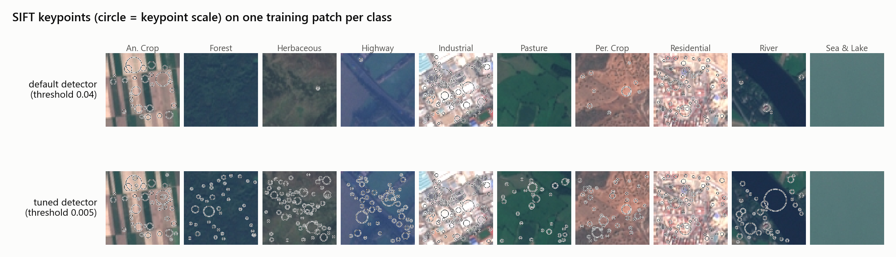

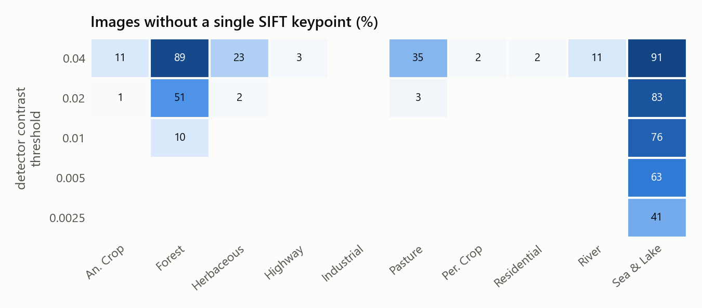

The paper does not say which SIFT implementation or settings were used, so we treated the
detector's contrast threshold as a hyper-parameter and selected it on the validation set of the
80/20 split (vocabulary and SVM fitted on the training images; test set not involved):

| Detector contrast threshold | keypoints per image | images without keypoint | validation acc., k = 100 | validation acc., k = 500 |
| :--- | ---: | ---: | ---: | ---: |
| 0.04 (OpenCV default) | 20.8 | 28.0% | 49.77 | 52.36 |
| 0.02 | 36.6 | 15.5% | 63.80 | 65.32 |
| 0.01 | 47.5 | 9.6% | 68.98 | 71.67 |
| 0.005 **(selected)** | 54.6 | 7.1% | 68.47 | 72.69 |
| 0.0025 | 58.0 | 4.5% | 67.96 | 72.18 |

The validation accuracy rises from 52% to 73% when the threshold is lowered and saturates
around 0.005, the value used for all Table II experiments. At that setting only Sea & Lake
still produces empty histograms (63% of its images) - which now *identifies* the class instead
of confusing it with Forest.

---

## 6. Results

### 6.1 Table II - accuracy for nine train/test splits

| Method |  | 10/90 | 20/80 | 30/70 | 40/60 | 50/50 | 60/40 | 70/30 | 80/20 | 90/10 |
| :--- | :--- | ---: | ---: | ---: | ---: | ---: | ---: | ---: | ---: | ---: |
| **BoVW (SVM, SIFT, k=10)** | paper | 54.54 | 56.13 | 56.77 | 57.06 | 57.22 | 57.47 | 57.71 | 58.55 | 58.44 |
|  | ours | 55.79 | 57.30 | 56.19 | 56.38 | 55.60 | 54.70 | 55.99 | 55.13 | 56.59 |
|  | ours − paper | +1.25 | +1.17 | -0.58 | -0.68 | -1.62 | -2.77 | -1.72 | -3.42 | -1.85 |
|  | ours, mean ± std (3 seeds) | 54.54 ± 1.37 | 55.91 ± 1.22 | 55.23 ± 0.84 | 56.45 ± 0.54 | 56.34 ± 0.69 | 56.05 ± 1.43 | 56.17 ± 0.19 | 56.06 ± 1.13 | 56.21 ± 0.48 |
| **BoVW (SVM, SIFT, k=100)** | paper | 63.07 | 64.80 | 65.50 | 66.16 | 66.25 | 66.34 | 66.50 | 67.22 | 66.18 |
|  | ours | 65.11 | 65.98 | 67.69 | 67.43 | 68.55 | 68.86 | 68.36 | 68.69 | 68.22 |
|  | ours − paper | +2.04 | +1.18 | +2.19 | +1.27 | +2.30 | +2.52 | +1.86 | +1.47 | +2.04 |
|  | ours, mean ± std (3 seeds) | 65.20 ± 0.44 | 66.56 ± 0.80 | 67.36 ± 0.42 | 67.35 ± 0.59 | 68.32 ± 0.21 | 68.56 ± 0.80 | 68.35 ± 0.52 | 68.67 ± 0.02 | 68.58 ± 0.31 |
| **BoVW (SVM, SIFT, k=500)** | paper | 65.62 | 67.26 | 68.01 | 68.52 | 68.61 | 68.74 | 69.07 | 70.05 | 69.54 |
|  | ours | 67.03 | 69.35 | 69.88 | 70.54 | 71.55 | 71.69 | 71.17 | 71.69 | 72.37 |
|  | ours − paper | +1.41 | +2.09 | +1.87 | +2.02 | +2.94 | +2.95 | +2.10 | +1.64 | +2.83 |
|  | ours, mean ± std (3 seeds) | 66.45 ± 0.58 | 69.12 ± 0.20 | 69.92 ± 0.05 | 70.50 ± 0.07 | 71.28 ± 0.26 | 71.28 ± 0.72 | 71.33 ± 0.15 | 71.59 ± 0.24 | 72.22 ± 0.26 |
| **CNN (two layers)** | paper | 75.88 | 79.84 | 81.29 | 83.04 | 84.48 | 85.77 | 87.24 | 87.96 | 88.66 |
|  | ours | 86.55 | 88.70 | 89.83 | 90.88 | 93.02 | 93.14 | 93.89 | 94.70 | 95.33 |
|  | ours − paper | +10.67 | +8.86 | +8.54 | +7.84 | +8.54 | +7.37 | +6.65 | +6.74 | +6.67 |
|  | ours, mean ± std (3 seeds) | 85.64 ± 1.11 | 88.13 ± 0.52 | 89.76 ± 0.19 | 91.20 ± 0.36 | 92.46 ± 0.60 | 92.83 ± 0.28 | 93.40 ± 0.49 | 94.14 ± 0.52 | 94.14 ± 1.04 |
| **ResNet-50** | paper | 75.06 | 88.53 | 93.75 | 94.01 | 94.45 | 95.26 | 95.32 | 96.43 | 96.37 |
|  | ours | 89.98 | 91.98 | 94.39 | 94.27 | 95.86 | 97.07 | 97.22 | 98.09 | 97.85 |
|  | ours − paper | +14.92 | +3.45 | +0.64 | +0.26 | +1.41 | +1.81 | +1.90 | +1.66 | +1.48 |
| **GoogLeNet** | paper | 77.37 | 90.97 | 90.57 | 91.62 | 94.96 | 95.54 | 95.70 | 96.02 | 96.17 |
|  | ours | 92.76 | 93.82 | 94.80 | 96.08 | 96.21 | 96.94 | 97.62 | 98.00 | 98.22 |
|  | ours − paper | +15.39 | +2.85 | +4.23 | +4.46 | +1.25 | +1.40 | +1.92 | +1.98 | +2.05 |

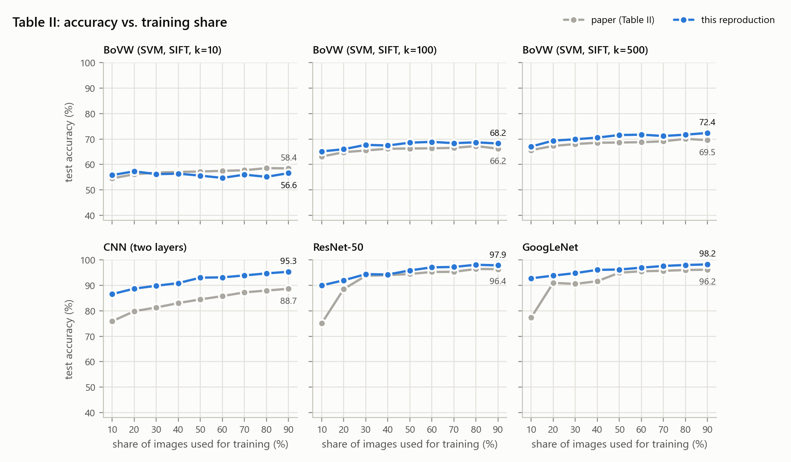

**BoVW rows: reproduced.** With the detector threshold chosen on validation data (Section 5.1)
our BoVW numbers are within 3.5 points of the paper in all 27 cells (k = 10 slightly below the
paper, k = 100 and 500 one to three points above), and show the same two trends: a larger
vocabulary helps (k = 10 < 100 < 500), and more training data helps little (from 10/90 to
90/10 the k = 500 pipeline gains about 5 points, the k = 10 pipeline almost nothing). The
bottleneck is the representation, not the amount of data. Over three seeds the standard
deviation of a cell is at most 1.4 points, so differences of one or two points to the paper are
within the variation one should expect from a different split and a different vocabulary.

**CNN rows: same ordering, but higher accuracies than the paper.** The qualitative conclusions
of the paper hold - every CNN beats every BoVW variant by a wide margin, the deep networks beat
the shallow one, and accuracy grows with the training share - but the absolute numbers differ
in two distinct ways:

* *Deep networks from scratch:* from 30/70 upwards ResNet-50 and GoogLeNet are 0.3 to 4.5
  points above the paper (ResNet-50 at 80/20: 98.09% vs. 96.43%). The large gaps are at the
  smallest training share: 89.98% vs. 75.06% (ResNet-50) and 92.76% vs. 77.37% (GoogLeNet) at
  10/90.
* *Two-layer CNN:* 6.7 to 10.7 points above the paper at *every* split (94.70% vs. 87.96% at
  80/20; 5.5 to 9.8 points for the mean of three seeds). A uniform gap points to a different
  network or training recipe rather than to training effort: the paper gives no architecture
  beyond "two layers".

*Why are our from-scratch networks so much better?* The paper does not report its training
procedure for these runs (optimiser, learning-rate schedule, number of epochs, augmentation,
input size), so the cause cannot be pinned down from the paper alone. The differences between
the two setups that we consider most likely, roughly in order of expected effect:

1. **Training effort on small splits.** We give small training sets a minimum number of
   optimiser steps (e.g. 82 epochs for ResNet-50 on 10/90, against 30 epochs on 80/20). If the
   paper trained every split for the same number of epochs, its 10% runs received about one
   eighth of the updates of its 80% runs and were probably under-trained. This fits the pattern
   that for the deep networks the gap to the paper is concentrated at the smallest split
   (15 points at 10/90, under 2 points at 80/20) and that the paper's curves jump by 13 points
   between 10/90 and 20/80, while ours rise smoothly. (Single runs are noisy on both sides:
   our ResNet-50 is slightly worse at 40/60 than at 30/70 and at 90/10 than at 80/20, the
   paper's GoogLeNet at 30/70 than at 20/80.)
2. **Augmentation.** We train with random flips and 90° rotations, which multiplies the
   effective training set by eight at no cost, because a satellite patch has no canonical
   orientation. The paper does not mention augmentation.
3. **A 2026 training recipe.** Batch-normalised architectures (also for GoogLeNet), warm-up and
   cosine learning-rate decay, Nesterov momentum and weight decay make training from random
   initialisation on 20k images far more reliable than typical 2017 setups.
4. **Model selection.** We keep the weights of the epoch with the best *validation* accuracy;
   the paper probably reports the last epoch. This usually matters by less than one point.

We checked that the higher numbers are not caused by information leaking from the test set:
each test set is evaluated exactly once, all selection uses validation images taken from the
training portion, and there are no duplicate or near-duplicate images across training and test
sets outside the nearly uniform Forest and Sea & Lake patches (Section 3.4).

A side effect is that the paper's argument for ImageNet pretraining becomes weaker in our
setting: the paper reports that fine-tuning gains "about 2%" over random initialisation (98.57%
vs. 96.43% for ResNet-50 on 80/20); with our recipe the gain is 0.7 points (98.76% vs. 98.09%).

### 6.2 Table III - fine-tuned ImageNet networks (80/20)

| Network (ImageNet-pretrained, 80/20) | paper | ours (seed 0) | 95% CI (seed 0) | ours, mean ± std over seeds | last layer only | val acc |
| :--- | ---: | ---: | ---: | ---: | ---: | ---: |
| ResNet-50 | 98.57 | 98.76 | [98.43, 99.02] | 98.86 ± 0.16 (n=3) | 94.33 | 98.47 |
| GoogLeNet | 98.18 | 98.24 | [97.85, 98.56] | 98.41 ± 0.17 (n=3) | 93.67 | 98.19 |

McNemar test, ResNet-50 vs GoogLeNet on the same 5,400 test images (seed 0): 60 images only ResNet-50 gets right, 32 only GoogLeNet; exact p = 0.005.

**Table III is reproduced.** The fine-tuned ResNet-50 reaches 98.76% (paper 98.57%), the
fine-tuned GoogLeNet 98.24% (paper 98.18%); both paper values lie inside our 95% confidence
intervals, and the ranking ResNet-50 > GoogLeNet is the same. On the same test images the two
networks disagree on 92 images, 60 of which only ResNet-50 gets right (exact McNemar test,
p = 0.005), so the difference is unlikely to be chance for this split. Repeating both runs
with two more seeds (a new split and a new initialisation each time) gives 98.86 ± 0.16%
(ResNet-50) and 98.41 ± 0.17% (GoogLeNet): the ranking holds on average, and the paper's
values lie within two standard deviations of our means.

The two training stages behave as the paper's recipe suggests: with the ImageNet features
frozen, training only the new last layer already gives 94.3% (ResNet-50) and 93.7% (GoogLeNet);
fine-tuning the whole network then adds about 4.5 points and removes three quarters of the
errors. The validation curves show the jump right after the backbone is unfrozen:

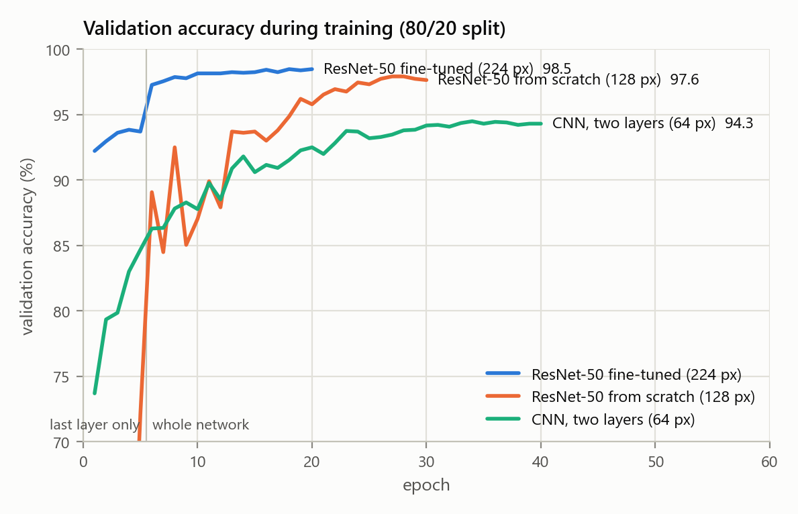

### 6.3 Comparing the paper's approaches

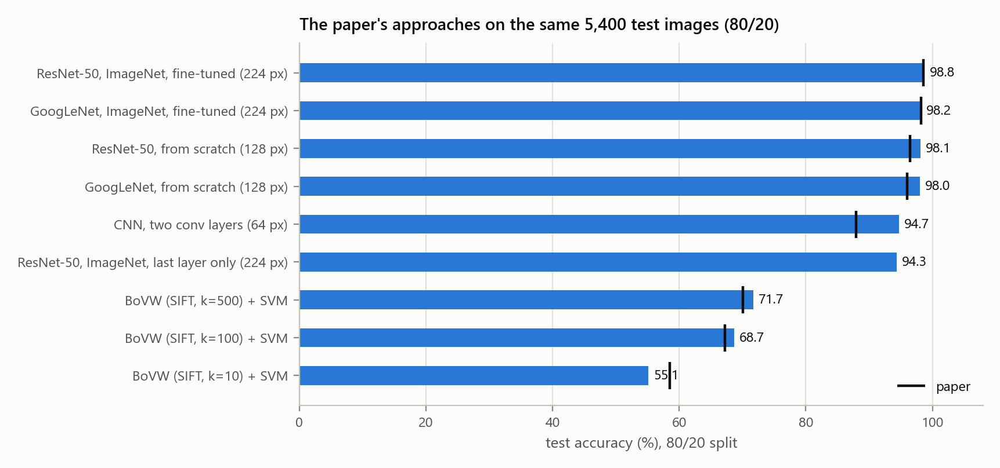

| Method (80/20 split, seed 0) | test acc | val acc | macro-F1 | paper | minutes |
| :--- | ---: | ---: | ---: | ---: | ---: |
| ResNet-50, ImageNet, fine-tuned (224 px) | 98.76 | 98.47 | 98.72 | 98.57 | 24.3 |
| GoogLeNet, ImageNet, fine-tuned (224 px) | 98.24 | 98.19 | 98.17 | 98.18 | 11.3 |
| ResNet-50, from scratch (128 px) | 98.09 | 97.92 | 98.04 | 96.43 | 13.3 |
| GoogLeNet, from scratch (128 px) | 98.00 | 97.92 | 97.95 | 96.02 | 14.9 |
| CNN, two conv layers (64 px) | 94.70 | 94.49 | 94.50 | 87.96 | 1.0 |
| ResNet-50, ImageNet, last layer only (224 px) | 94.33 | – | – | – | – |
| BoVW (SIFT, k=500) + SVM | 71.69 | 72.69 | 70.53 | 70.05 | 11.4 |
| BoVW (SIFT, k=100) + SVM | 68.69 | 68.47 | 67.43 | 67.22 | 2.3 |
| BoVW (SIFT, k=10) + SVM | 55.13 | 56.57 | 53.22 | 58.55 | 4.2 |

Reading the table from the bottom up shows what each modelling step of the paper adds on the
same 5,400 test images:

| Step | From | To | Gain |
|---|---:|---:|---:|
| BoVW: vocabulary of 10 -> 500 visual words | 55.1 | 71.7 | +16.6 |
| best BoVW -> two-layer CNN | 71.7 | 94.7 | +23.0 |
| two-layer CNN -> deep network from scratch (ResNet-50) | 94.7 | 98.1 | +3.4 |
| deep network from scratch -> ImageNet-pretrained and fine-tuned | 98.1 | 98.8 | +0.7 |

* **Learned features are the largest single jump.** Even a CNN with two convolution layers and
  0.2 M parameters beats the best bag-of-words pipeline by 23 points while training in about
  one minute. Depth adds another 3.4 points.
* **The BoVW representation has a low ceiling.** A larger vocabulary helps (k = 10 -> 500:
  +16.6 points), but SIFT describes grey-level gradients around a few keypoints; on 64 x 64
  patches at 10 m resolution much of the class information is colour and fine texture
  (Section 7.3).
* **Frozen ImageNet features are not enough.** Stage 1 of the paper's fine-tuning recipe - a
  new last layer on top of frozen ResNet-50 features - reaches 94.3%, no better than the small
  CNN trained on EuroSAT; ImageNet features need to be adapted to satellite imagery, and full
  fine-tuning (stage 2) gives the best model overall.
* **Cost.** The fine-tuned ResNet-50 needs about 24 minutes on a laptop GPU; the from-scratch
  ResNet-50 at 128 px reaches within 0.7 points in about half that time; the two-layer CNN gives
  94.7% in one minute. The BoVW pipelines took 2 to 11 minutes on the CPU, mostly for the SVM.

---

## 7. Error analysis

### 7.1 Class-level results of the best model

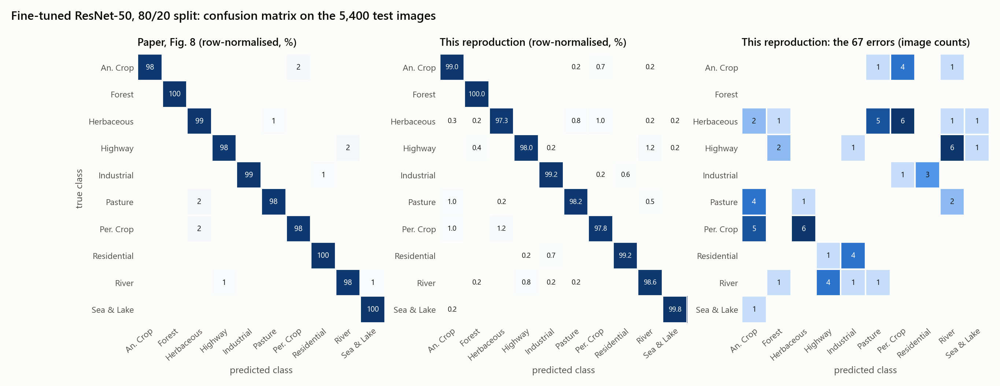

| Class | test images | precision | recall | F1 |
| :--- | ---: | ---: | ---: | ---: |
| AnnualCrop | 600 | 98.02 | 99.00 | 98.51 |
| Forest | 600 | 99.34 | 100.00 | 99.67 |
| HerbaceousVegetation | 600 | 98.82 | 97.33 | 98.07 |
| Highway | 500 | 98.99 | 98.00 | 98.49 |
| Industrial | 500 | 98.80 | 99.20 | 99.00 |
| Pasture | 400 | 98.25 | 98.25 | 98.25 |
| PermanentCrop | 500 | 97.80 | 97.80 | 97.80 |
| Residential | 600 | 99.50 | 99.17 | 99.33 |
| River | 500 | 98.01 | 98.60 | 98.31 |
| SeaLake | 600 | 99.67 | 99.83 | 99.75 |
| **all (accuracy / macro-F1)** | 5400 |  | 98.76 | 98.72 |

| Class pair (A / B) | A predicted as B | B predicted as A | errors | share of all errors |
| :--- | ---: | ---: | ---: | ---: |
| HerbaceousVegetation / PermanentCrop | 6 | 6 | 12 | 18% |
| Highway / River | 6 | 4 | 10 | 15% |
| AnnualCrop / PermanentCrop | 4 | 5 | 9 | 13% |
| Industrial / Residential | 3 | 4 | 7 | 10% |
| HerbaceousVegetation / Pasture | 5 | 1 | 6 | 9% |
| AnnualCrop / Pasture | 1 | 4 | 5 | 7% |
| Pasture / River | 2 | 1 | 3 | 4% |
| Forest / Highway | 0 | 2 | 2 | 3% |

The fine-tuned ResNet-50 misclassifies 67 of the 5,400 test images. Every class is recognised
with a recall of at least 97.3%. Forest (100%), Sea & Lake (99.8%), Industrial and Residential
(99.2% each) are practically solved; the weakest classes are Herbaceous vegetation (97.3%) and
Permanent crop (97.8%).

The errors are not spread evenly. They fall into the three groups of look-alike classes that
the exploration in Section 3.3 pointed to, and that the paper names as well ("the classifier
sometimes confuses the agricultural land classes as well as the classes highway and river"):

| Group | Errors | Share |
|---|---:|---:|
| among Annual crop, Permanent crop, Pasture, Herbaceous vegetation | 34 | 51% |
| Highway / River | 10 | 15% |
| Industrial / Residential | 7 | 10% |
| all other pairs | 16 | 24% |

Compared with the paper's Fig. 8 (left panel; it is printed with two decimals, so 0.01 there
stands for anything between 0.5% and 1.5%), the diagonal agrees to within about one point for
nine classes; the largest deviation is Herbaceous vegetation (paper 0.99, ours 97.3%). The
paper's four largest off-diagonal entries (0.02 each: Annual crop as Permanent crop, Highway as
River, Pasture as Herbaceous, Permanent crop as Herbaceous) are the same kind of confusions we
find, with three of the four among our most frequent ones. With only about one error per
hundred images, the exact cell values differ, as expected: a cell with 6 errors has a standard
deviation of about 2.5.

### 7.2 What the errors look like

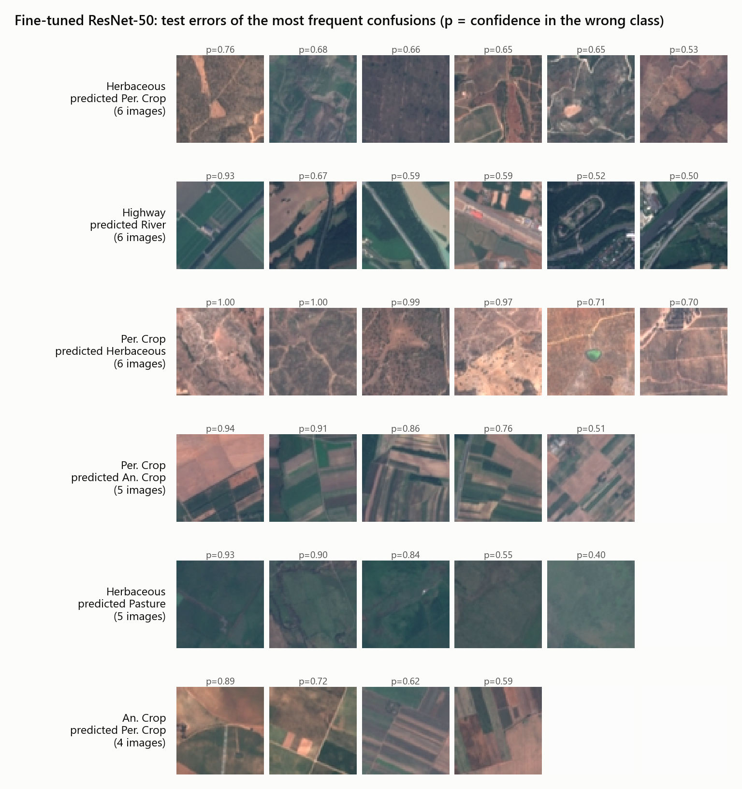

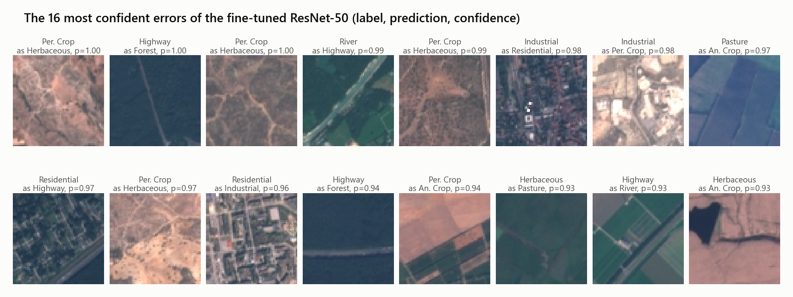

The network is usually unsure when it is wrong: its mean confidence is 0.993 on correct
predictions but 0.737 on errors, and in 63 of the 67 errors the true class is its second
choice. Looking at the images explains most of the remaining mistakes:

* **Two land covers in one patch.** "Highway" patches that are almost entirely forest with a
  thin road are answered "Forest" (twice, with confidence 1.00 and 0.94); a residential block
  with a major road through its corner is answered "Highway". The dataset gives one label per
  640 m patch, but the patch often contains two classes, and the network sometimes picks the
  other one.
* **Rivers and roads.** Both are narrow bands crossing fields or forest. Light, sediment-laden
  rivers are read as roads, and dark roads or canals as rivers (10 errors).
* **Permanent crop vs. herbaceous vegetation.** Several "Permanent crop" patches show dry,
  irregular scrub without visible rows or parcel structure and are confidently (p ≥ 0.97)
  classified as herbaceous vegetation. At 10 m per pixel an olive grove or vineyard on dry
  ground and natural scrub look very much alike; whether the label or the prediction is "right"
  cannot be decided from the image alone.
* **Annual crop, permanent crop, pasture.** Rectangular parcels are the cue for crops; pasture
  with visible parcel boundaries is read as annual crop, and harvested or bare fields move
  between the two crop classes. Part of this is seasonal: the same field looks different in
  spring and after harvest.

So a large part of the last 1.2% is ambiguity of the labelling scheme rather than a weakness of
the classifier. 18 errors are made with confidence above 0.9; these are the ones most worth a
second look by a human annotator.

### 7.3 Where the simpler methods fail

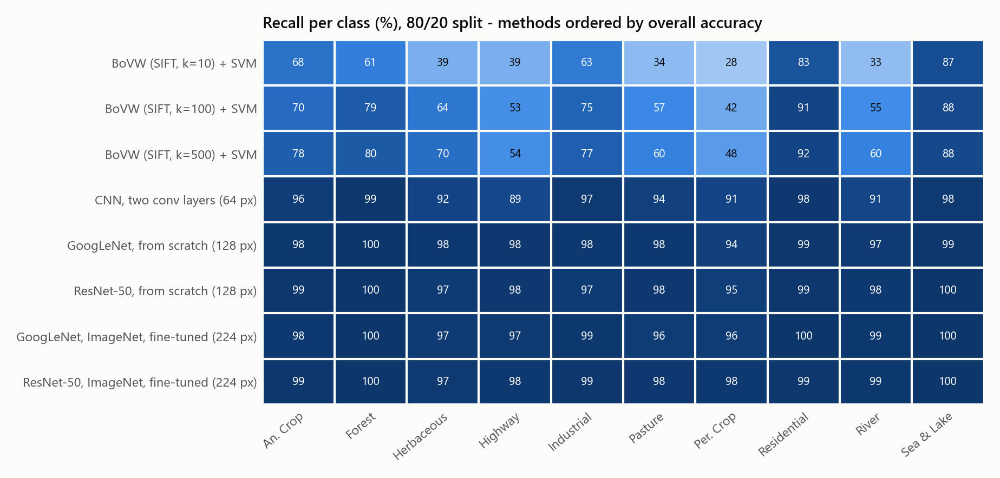

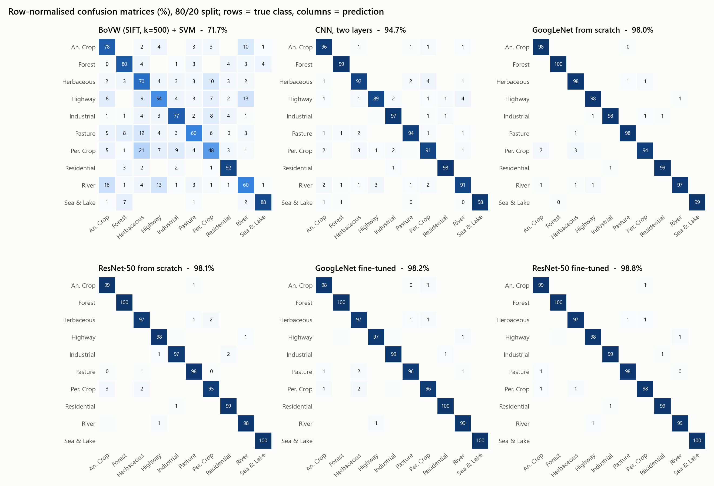

All approaches stumble over **the same class pairs**; better models shrink these confusions
but do not change which ones remain:

| Approach (80/20) | Accuracy | Weakest classes (recall) | Largest confusions (images) |
|---|---:|---|---|
| BoVW (SIFT, k=500) + SVM | 71.7 | Permanent crop 48, Highway 54, Pasture 60, River 60 | Per. crop as Herbaceous 106, River as An. crop 78, Highway as River 67 |
| CNN, two layers | 94.7 | Highway 89, Permanent crop 91, River 91 | Herbaceous as Per. crop 24, Highway as River 20, River as Highway 16 |
| GoogLeNet from scratch | 98.0 | Permanent crop 94 | Per. crop as Herbaceous 15, Per. crop as An. crop 12 |
| ResNet-50 from scratch | 98.1 | Permanent crop 95 | Per. crop as An. crop 13, Per. crop / Herbaceous 12 + 12 |
| ResNet-50 fine-tuned | 98.8 | Herbaceous 97 | Per. crop / Herbaceous 6 + 6, Highway as River 6 |

* **Highway / River** costs the bag of words 130 errors: both classes are a narrow band
  crossing some other land cover, and most SIFT keypoints fall on the background. The two-layer
  CNN already brings this down to 36, and the deep networks to 9-14: thin, continuous lines are
  exactly what convolution filters detect.
* **Permanent crop / Herbaceous vegetation** stays the hardest pair for every method, including
  the best one (BoVW 167 errors, two-layer CNN 37, deep networks from scratch 23-24, fine-tuned
  ResNet-50 12). The distinguishing cue - regular rows of trees or vines - is at the limit of a
  10 m pixel, which matches the visual ambiguity seen in Section 7.2.
* **Forest and Sea & Lake** are harder for SIFT (80% and 88% recall) than for any CNN (at least
  98%): they contain little grey-level texture, and many Sea & Lake patches produce no keypoint
  at all (Section 5.1). Residential, conversely, is the class where SIFT's local structure is
  strongest (92% recall, its best class).

The ranking of the approaches thus follows how much *spatial* structure they capture: local
grey-level gradients around a few keypoints (SIFT words) < learned multi-layer filters, with
ImageNet pretraining adding robustness on the subtle agricultural distinctions.

---

## 8. Limitations

**About the reproduction**

* *The paper under-specifies its experiments.* Input size, optimiser, schedule, number of
  epochs, augmentation, the SIFT implementation and the SVM kernel are not given. Our numbers
  therefore reproduce the paper's *protocol and conclusions*, not its exact training runs.
  Where our results are far above the paper's (two-layer CNN, networks trained from scratch) we
  cannot tell which of these unknowns is responsible (Section 6.1 lists the likely candidates).
* *Only the RGB experiments.* The band-combination study, the other four datasets and the
  application examples are outside the scope set by the project brief.
* *One GoogLeNet variant.* torchvision's GoogLeNet uses batch normalisation; the 2015 original,
  which the paper presumably used, does not.

**About the evaluation**

* *Random patch-level splits.* As in the paper, test patches come from the same satellite
  scenes, regions and dates as training patches. We found no pixel-identical twins across the
  split (Section 3.4), but neighbouring patches share haze, season and landscape. The reported
  accuracies say how well a model fills gaps in a region it has seen, not how it transfers to a
  new country or year. The RGB archive carries no geo-reference, so a geographic hold-out was
  not possible here.
* *Hyper-parameters were chosen once.* The SIFT detector threshold and the training recipes
  were fixed using the 80/20 split (the recipes before seeing any result, the threshold on that
  split's validation images) and then reused for all ratios. For training shares below 80%
  those validation images are part of the test set, so for these columns the choice of this one
  scalar is not strictly independent of the test data. The per-run decisions (SVM constant,
  checkpoint) always used the run's own validation set.
* *The test set was looked at more than once.* Each run touches its test set once, but many
  methods are evaluated on the same 80/20 test images, and we decided to tune the SIFT detector
  after seeing that the default detector failed. Comparisons between methods that differ by
  tens of points are safe; rankings among the best models are not (next point).
* *Precision.* The ResNet-50 and GoogLeNet rows of Table II come from a single seed (the BoVW
  and two-layer CNN rows and Table III from three). With 5,400 test images the 95%
  interval of an accuracy near 98.5% is about ±0.3 points, and the spread between seeds is of
  the same size, so differences of a few tenths between strong models are within noise.
* *Near the ceiling the labels are the limit.* Many remaining errors are patches containing two
  land covers or visually ambiguous classes (Section 7.2). Overall accuracy cannot separate
  such cases from real mistakes; a multi-label or per-pixel annotation would be needed.

**About the methods**

* *One BoVW configuration.* One classifier (RBF-SVM), a coarse grid for its constant, no
  spatial pyramid, grey-level SIFT only - a direct reading of the paper's one-line description.
  Better hand-crafted pipelines certainly exist.
* *From-scratch networks at 128 px.* To afford eighteen from-scratch runs on a laptop GPU,
  Table II uses 128 x 128 inputs instead of the 224 x 224 used for fine-tuning, so the
  scratch-vs-pretrained comparison of Section 6.1 is not at equal input size.
* *RGB JPEGs.* The images are 8-bit, lossy-compressed and not atmospherically corrected.
  Sentinel-2 offers ten further bands (near and short-wave infrared) that carry exactly the
  information needed for the vegetation classes; they were out of scope here.

---

## 9. Reproducing this report

```bash
python scripts/00_prepare_data.py        # download + verify + decode + splits
python scripts/01_eda.py                 # Section 3
python scripts/02a_tune_bovw.py          # Section 5.1 (validation only)
python scripts/02_classical.py --paper-only --seeds 0 1 2 --jobs 8   # BoVW rows of Table II
python scripts/03_cnn.py --queue core    # CNN rows of Table II, Table III, Fig. 8
python scripts/03_cnn.py --queue seeds   # seeds 1 and 2 (two-layer CNN, fine-tuned networks)
python scripts/04_report.py              # tables, figures and this file
```

Environment used: Windows 11, Python 3.10.18, PyTorch 2.7.1 + CUDA 12.8 (cuDNN 9.7),
torchvision 0.22.1, scikit-learn 1.7.1, OpenCV 5.0.0, NumPy 2.2.6; Ryzen 9 8945HX, 32 GB RAM,
GeForce RTX 5060 Laptop GPU (8 GB). Every run's configuration and metrics are in
`results/runs/*.json`; `results/tables/all_runs.csv` lists them all.

## References

1. P. Helber, B. Bischke, A. Dengel, D. Borth. EuroSAT: A Novel Dataset and Deep Learning
   Benchmark for Land Use and Land Cover Classification. arXiv:1709.00029v2, 2019.
2. D. G. Lowe. Distinctive Image Features from Scale-Invariant Keypoints. IJCV 60(2), 2004.
3. K. He, X. Zhang, S. Ren, J. Sun. Deep Residual Learning for Image Recognition. CVPR 2016.
4. C. Szegedy et al. Going Deeper with Convolutions. CVPR 2015.
5. Y. Yang, S. Newsam. Bag-of-Visual-Words and Spatial Extensions for Land-Use Classification.
   ACM SIGSPATIAL 2010.
